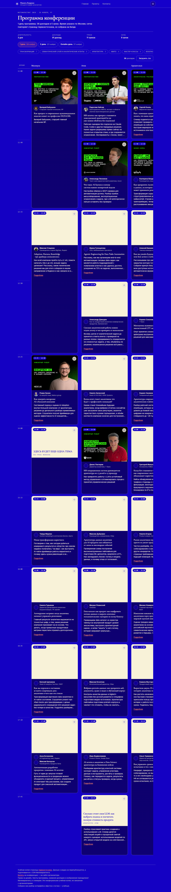
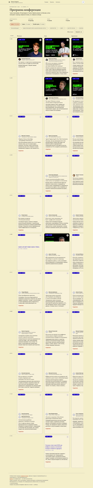
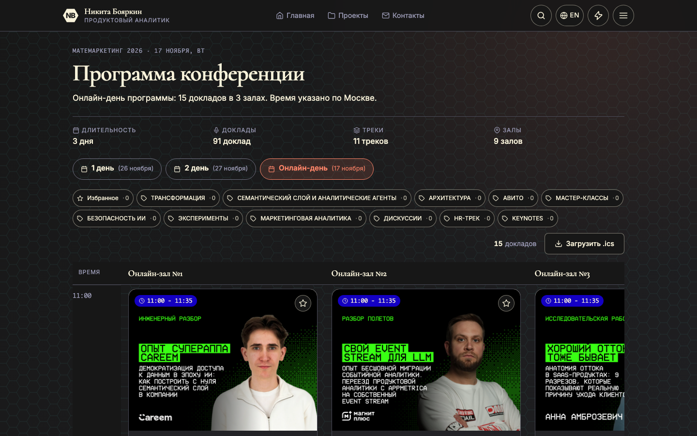
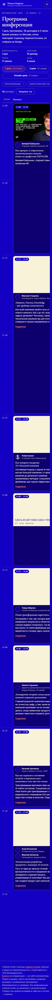

# mm-program-page

Программа конференции **Матемаркетинг 2026** (`lms.matemarketing.ru/events/all/6/program`),
переписанная на **Astro 7 + Bun**: 3 дня, 91 доклад, 11 треков, 9 залов, сетка «время × залы»
на десктопе и хронологический список на мобильном, карточки с баннерами, фильтры по треку
и по избранному, модалка доклада и экспорт дня в `.ics`.

Проект — разбор чужого интерфейса до состояния воспроизведения, а не лендинг. Страница
измерена, данные вытянуты из публичного API, вёрстка собрана заново и сверена с эталоном.
Версия 2.0 добавляет вторую половину задачи: **тот же экран, но собранный как настоящий
фронтенд** — билд, типы, юнит-тесты, браузерные тесты и HTML, который читается без JavaScript.



| Тёмная, день 1 | Светлая, день 1 |
| --- | --- |
|  |  |

| Киберпанк, онлайн-день | Мобильный 390 px |
| --- | --- |
|  |  |

Все четыре снятия — с собранной страницы (`astro preview` + Playwright), не мокапы.

## Что даёт переписывание

| Было (v1) | Стало (v2) |
| --- | --- |
| `index.html` + 3 файла, двойной клик по `file://` | Astro: 4 маршрута + JSON-эндпоинт, `bun run build` |
| Сетка рисуется в браузере из `window.MM_PROGRAM` | Сетка **лежит в HTML**: три страницы по 39 / 37 / 15 карточек, у каждого дня свой URL |
| Переключение дня — клиентское, состояние в памяти | День — это адрес: `/`, `/day/2/`, `/day/3/` — ссылки, история, шаринг |
| `app.js` — IIFE на 780 строк без типов | `src/lib/program.ts` + `src/lib/ics.ts` — типизированное ядро, 56 юнит-тестов без браузера |
| Тесты — Python + headless Chrome | `bun test` (56) + Playwright на собранной странице, включая прогон с выключенным JS |
| Свой набор CSS на 2381 строку с фиолетовым брендом | Токены портфельной дизайн-системы: три темы, Inter + Cormorant, кремовые баннеры |

Что это даёт на выходе: **150 КБ HTML (20.8 КБ gzip) на день программы и один клиентский
чанк 13.0 КБ (5.0 КБ gzip)**. Без JavaScript страница показывает всю сетку, табы дней, чипы
треков и счётчик — это проверено тестом, а не заявлено.

## Измерения

Снято в Chromium на собранной странице (`1440×900`, тёмная тема), сверено с эталоном v1:

| Метрика | Оригинал | v1 | v2 |
| --- | ---: | ---: | ---: |
| Колонка времени | 99 px | 99–100 px | **100 px** |
| Колонка зала | 420 px | 420 px | **420 px** |
| Карточка | 391 px | 391 px | **391 px** |
| Радиус карточки | 16 px | 16 px | **16 px** |
| Баннер | 4:3 | 4:3, 291 px | **389×292 px, 4:3** (на всю ширину карточки) |
| Строка сетки | 550 px | 550 px | **520–643 px** (минимум 520 + контент) |
| Верх сетки | y = 414 | y = 414 | **y = 527** (выше шапка: заголовок, факты, табы, чипы) |
| Высота документа | 6605 px | 6589 px | 7475 px |

Колонки, карточка и радиус совпадают с эталоном. Строка и высота документа выросли
сознательно: баннер теперь занимает всю ширину карточки в режиме 4:3, а над сеткой появился
заголовок страницы с фактами. Это зафиксировано в `docs/DECISIONS.md` как отклонение, а не
выдаётся за 1:1.

Мобильный режим (390 px) — не сжатая сетка, а хронологический список: та же разметка,
`display: flex` на контенте, время становится липким разделителем группы, зал — бейджем
в карточке, баннер скрыт (посмотреть его можно в модалке). Горизонтального скролла у
документа нет вовсе, зато день 1 вырастает до 15 454 px против 7 479 px у сжатой сетки,
которая держала ~5.7× содержимого за горизонтальным скроллом. Цифры и обоснование —
`docs/DECISIONS.md`, §10. Меню уезжает в drawer; шапка, табы дня и разделитель времени
образуют одну липкую цепочку с посчитанными смещениями.

## Структура

```
src/
  data/program.json            нормализованный слепок API — единственный источник данных
  lib/program.ts              типы + чистая логика: дни, залы, строки, span, коллизии, подписи
  lib/ics.ts                  RFC 5545: экранирование, перенос по 75 октетов, VTIMEZONE
  lib/theme.ts               три темы, цвета для meta theme-color, nextTheme
  layouts/Base.astro          <head>, тема до первой отрисовки, шапка с drawer'ом, подвал
  components/ProgramPage.astro  день целиком: шапка, табы, чипы, тулбар, сетка, модалка
  components/TalkCard.astro   карточка доклада (рендерится на билде)
  components/Nav.astro        шапка, off-canvas меню, дни, тема
  pages/index.astro           день 1  →  /
  pages/day/[n].astro         дни 2..N →  /day/2/, /day/3/
  pages/program.json.ts       /program.json — тот же слепок для клиента (модалка, .ics)
  pages/404.astro             честная 404
  scripts/program-client.ts   единственный JS: тема, drawer, фильтр, избранное, модалка, .ics
  styles/tokens.css           токены трёх тем + self-hosted Inter/Cormorant
  assets/fonts/*.woff2        восемь подмножеств, проходят через бандлер
  styles/site.css             каркас: страница, шапка, drawer, кнопки, подвал
  styles/program.css          табы, чипы, сетка, карточка, модалка, печать
data/program.raw.json         сырой ответ API (вход для пересборки)
scripts/fetch-program.ts      скачивание + нормализация + --check / --dry-run
tests/lib/*.test.ts           56 юнит-тестов ядра (bun test)
tests/built/program.spec.ts   браузерные тесты собранной страницы (Playwright)
docs/reference/*.png          скриншоты ОРИГИНАЛА — эталон для сверки, не текущей версии
docs/screenshots/*.png        скриншоты текущей сборки
CONTRACT.md                   замороженный контракт: данные, DOM-хуки, поведение
docs/DECISIONS.md             почему сделано так и где сознательно расходится с оригиналом
```

## Команды

```bash
bun install
bun run dev                # http://localhost:4321
bun run build              # dist/ — статика
bun run preview            # посмотреть собранное

bun run check              # astro check (типы в .astro и .ts)
bun test                   # 56 юнит-тестов ядра
bun run test:built         # браузерные тесты на собранной странице

bun run data:fetch         # перекачать API и пересобрать src/data/program.json
bun run data:check         # пересобрать из сырого ответа и сверить со слепком
bun run data:dry           # посчитать, ничего не записывая
```

Порядок для `test:built`: сначала `bun run build` — Playwright поднимает `astro preview`
и проверяет именно то, что уедет на хостинг. Если preview остался висеть после ручного
запуска, `bunx astro preview stop` снимет лок, иначе следующий прогон упрётся в «preview
already running».

## Данные

Первоисточник — публичный эндпоинт платформы:

```
GET https://lms.matemarketing.ru/api/event-program/event/6/
```

Страница первоисточника — Vue SPA: в HTML приходит пустой `<div id="app">`, поэтому данные
взяты из API, а не выскоблены из DOM. `scripts/fetch-program.ts` нормализует payload:

- `short` = `short_description`, иначе первый абзац `description`, иначе `""`;
- `lectors[].name` = имя + фамилия (+ отчество);
- тексты — плоский plain text: теги сняты, сущности раскодированы, пробелы схлопнуты;
- `days[].halls` = залы, у которых в этот день есть доклады, в порядке `hall.order`.

Слепок записывается стабильно (`JSON.stringify(payload, null, 2)` + перевод строки), поэтому
`data:check` пересобирает его из сырого `data/program.raw.json` и сравнивает побайтово
с **закоммиченным слепком** `src/data/program.json` (`scripts/fetch-program.ts:500-513`):
расхождение даёт exit 1 и unified diff. Сырой ответ — только вход пересборки
(`:485-495`), живой API видит исключительно `--fetch`. Единственное
исключённое поле — `generatedAt`: он ставится в момент сборки (`scripts/fetch-program.ts:261`),
поэтому маскируется в обеих сторонах сравнения, иначе проверка была бы красной всегда.
Любое другое расхождение — красное.

В данных есть три свойства, которые нельзя «починить» в вёрстке и которые нужно знать:

1. **13 докладов без баннера и 10 без спикеров** — карточка умеет оба состояния.
2. **У 27 докладов `trackId === null`**, а у всех 15 докладов онлайн-дня пустой трек. Поэтому
   сумма счётчиков чипов за день меньше числа докладов, а на `/day/3/` все 11 чипов дают 0:
   это свойство источника, а не баг фильтра.
3. **Один доклад (`id 362`, «ЗДЕСЬ БУДЕТ ЕЩЕ ОДНА ТЕМА») без описания вообще** — единственный,
   у кого `short` пуст; тест закрепляет его как именованное исключение.

## Проверка

```bash
bun test                  # 56 pass — данные, сетка, календарь
bun run test:built        # браузерные тесты — собранная страница в Chromium
```

`tests/lib` проверяет инварианты слепка (91 доклад, 3 дня, форма времени, отсутствие HTML
в текстах, соответствие залов и дней) и чистую логику: `spanOf` (доклад через 2–3 строки),
`placeTalks` (коллизия в одном зале и укорачивание предыдущего слота), `pluralTalks`,
`resolveDay`, `buildCalendar` (стабильный вывод, перенос по октетам, `DTSTART/DTEND`).

`tests/built` проверяет собранный HTML: 39/37/15 карточек, 91 уникальный `data-talk-id`,
активный таб, фильтр с `?track=` и снятием, избранное с перезагрузкой, модалку с фокус-трапом,
скачанный `.ics` с 39 `VEVENT`, мобильный вид на 390 (нет горизонтального overflow у документа,
время — липкий разделитель), drawer на 390 и 1440, три темы,
печать без потерянных заголовков, `/program.json` и **прогон с `javaScriptEnabled: false`**.

## Что осталось 1:1, а что изменилось

**1:1:** количество и состав данных, семантика сетки (колонки, `span`, пустые ячейки, sticky
время и шапка залов), состав карточки (время, трек, зал, спикеры, тезисы, «Подробнее»),
сценарии (фильтр, избранное, модалка, `.ics`, drawer) и метрики колонок — 100 / 420 / 391 / 16.

**Сознательно не 1:1:**

- **Палитра и типографика** — вместо фиолетового бренда Матемаркетинга и Open Sans/Unbounded
  взята дизайн-система портфолио: индиго `#1400c3` / крем `#f4efca` / киберпанк, Inter и
  Cormorant. Тема переключается на клиенте и запоминается.
- **Каркас страницы** — левая app-панель оригинала (навигация, «премиум-замки», юридический
  блок) заменена на шапку сайта с off-canvas меню и подвал с указанием прав.
- **Строка сетки и баннер** — 520–643 px и баннер на всю ширину карточки (4:3) вместо
  фиксированных 550 px с баннером 291 px.
- **Мобильный экран** — хронологический список в одну ось вместо сжатой сетки с
  горизонтальным скроллом: шапка залов, баннер и время в карточке на ≤ 767.98 px скрыты,
  зал приходит бейджем. Обоснование и цена — `docs/DECISIONS.md`, §10.
- **Переключение дня** — ссылка и отдельная страница вместо клиентской перерисовки.

## Чего нет

Авторизации, личного кабинета, серверного избранного, чата, плеера и оплаты — это статика.
Баннеры и фото спикеров подтягиваются с CDN первоисточника, в репозитории их нет. Счётчик
показывает число докладов, а не «людей онлайн»: у статики нет присутствия, и выдумывать его
нельзя. Права на дизайн, тексты программы и изображения принадлежат Матемаркетингу и спикерам;
это неофициальная учебная копия.

## Деплой

`astro.config.mjs:7-8` уже задаёт оба поля деплоя: `site: "https://nikitaboyarkin.github.io"`
и `base: "/mm-program-page"` — проект публикуется как project-страница GitHub Pages.
Формат URL берётся из `BASE_URL` (`src/lib/program.ts`), поэтому обе схемы проверены:

- **project-страница** (`/mm-program-page/`) — текущая конфигурация: `bun run build` и
  выкладка `dist/`. Ссылки дней ведут на `/mm-program-page/day/2/`, favicon и
  `/mm-program-page/program.json` получают префикс автоматически;
- **корень домена** — снять `base` (и заменить `site` на свой домен): `BASE_URL` станет `/`,
  остальное поедет без правок.

Шрифты лежат в `src/assets/fonts` и проходят через бандлер, поэтому получают
хеш и префикс автоматически; в `public/` их держать нельзя — оттуда Vite не переписывает
пути.

Сборка с текущим `base` проверена прогоном в Chromium: табы, модалка (значит `/program.json`
доступен), шрифты `200`, консоль чистая.
